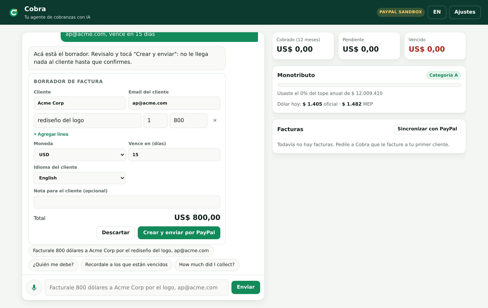
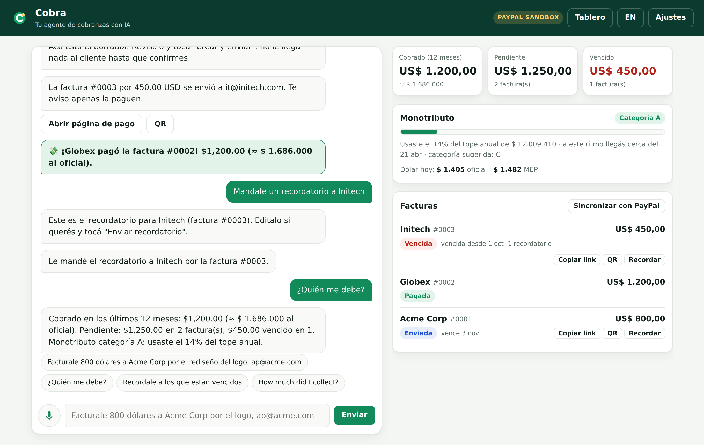
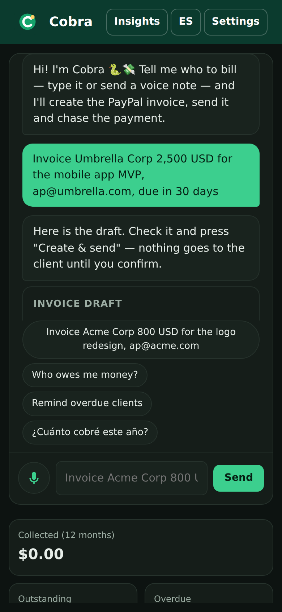
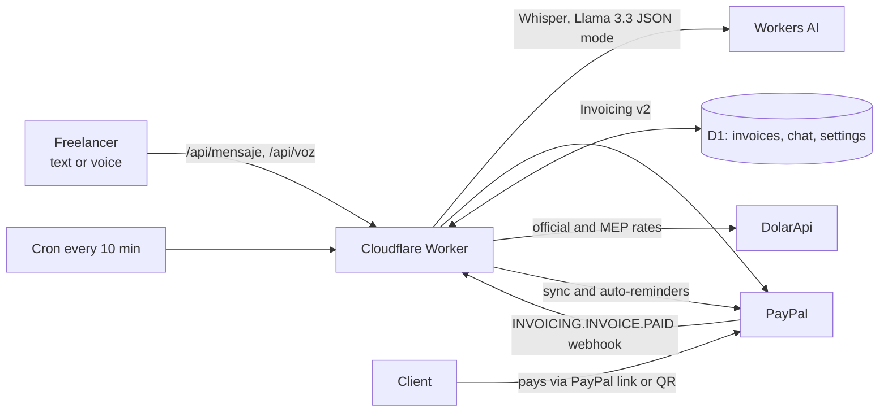

# Cobra 🐍💸 — the AI collections agent for freelancers paid with PayPal

**Tell Cobra who to bill, by text or voice note, in English, Spanish or Portuguese. It drafts the PayPal invoice, sends it once you confirm, chases late payers on its own and tracks what you earned in local currency, including Argentina's *monotributo* income cap.**

Built for the [PayPal AI Hackathon](https://paypalaihackathon.devpost.com/) · PayPal Invoicing v2 + Webhooks (sandbox) · Cloudflare Workers AI (Llama 3.3 70B, Whisper) · Cloudflare Workers + D1.

| Chat → draft → invoice | Reminders, payments and dashboard | Mobile |
|---|---|---|
|  |  |  |

## The problem

Millions of freelancers in Latin America work for clients abroad and get paid through PayPal. The work is the easy part. The admin around getting paid is the hard part:

- **Invoices are tedious.** Opening a dashboard, filling forms in English and copying emails takes time, and often happens on a phone between other tasks.
- **Chasing payments is awkward.** Nobody enjoys writing the third "friendly reminder", so invoices sit unpaid for weeks.
- **Local rules are invisible to global tools.** An Argentine *monotributista* is expelled from the simplified tax regime if their yearly income passes a cap measured in **pesos at the official exchange rate**. No invoicing tool tracks that.

## What Cobra does

1. **Bill in one sentence or one voice note.** Examples: *"Facturale 800 dólares a Acme Corp por el rediseño del logo, ap@acme.com"* or *"Invoice Globex 1,200 USD for the landing page"*. Cobra extracts the client, email, line items, currency and due date into an **editable draft**.
2. **Human in the loop.** Nothing reaches a client until you press **Create & send**. Cobra then creates the invoice with PayPal (next invoice number, draft, send) and gives you the payment link and a QR code.
3. **It chases late payers for you.** Ask *"remind Initech"* and Cobra writes a warm reminder in the **client's** language, which you can edit before sending. With auto-reminders on, the agent reminds overdue clients by itself, at most every 3 days and at most 3 times.
4. **It knows when you get paid.** PayPal webhooks (`INVOICING.INVOICE.PAID`, signature verified through PayPal's API), plus a sync every 10 minutes, update the invoice and tell you in the chat: *"💸 Globex paid invoice #0002! $1,200 (≈ $1.686.000 at the official rate)"*.
5. **Money questions in plain language.** Ask *"who owes me money?"* or *"¿cuánto cobré?"*. Answers come from your real data and are never invented by the model.
6. **Local reality built in.** The dashboard shows:
   - income converted to pesos at the official and MEP rates;
   - a **monotributo meter** with the 2026 ARCA caps: how much of your category you used, when you would hit the cap at your current pace, and which category you will need.

## How PayPal and AI are used

| | What | Where |
|---|---|---|
| **PayPal Invoicing v2** | `generate-next-invoice-number`, create draft, `send`, `remind`, `cancel`, record external payment (`payments`), get and list invoices | [`src/paypal.js`](src/paypal.js) |
| **PayPal Webhooks** | Registers `INVOICING.INVOICE.*` events once and verifies every delivery with `verify-webhook-signature` before trusting it | [`src/index.js`](src/index.js) |
| **LLM: Llama 3.3 70B on Workers AI** | Turns free text (ES/EN/PT, slang like "lucas") into one structured action with **JSON-schema-constrained output**: create, remind, cancel, mark paid or query. It also writes reminders in the client's language. | [`src/agente.js`](src/agente.js) |
| **Speech: Whisper (large-v3-turbo) on Workers AI** | Voice notes, the way freelancers in LatAm actually communicate | [`src/agente.js`](src/agente.js) |

### Guardrails

- **The model only proposes.** Code validates every field (emails, amounts, currencies, due dates) and you confirm every client-facing action.
- **No invented data.** The prompt forbids inventing emails or amounts. Missing fields are flagged in the draft for you to fill in.
- **Graceful degradation.** If the model fails or returns invalid JSON, a deterministic rule-based parser takes over, so the app keeps working.
- **Grounded answers.** Money totals come from the database, not from the LLM.

## Architecture



- **One Worker** serves the static app and the JSON API.
- **D1** keeps a local copy of invoices, conversation history and settings. PayPal stays the source of truth.
- **Each browser gets its own workspace**, held in a signed, HttpOnly cookie, so judges can try it without signing up.
- **Security:**
  - Strict CSP with no inline scripts.
  - CSRF protection: every state-changing call needs a custom header.
  - Rate limit of 40 messages per hour per workspace.
  - Webhook signatures verified with PayPal.
  - Secrets live only in Cloudflare.

## Try it

**Hosted demo: https://cobra.peshino2012.workers.dev** (no sign-up: each browser gets its own workspace). Everything runs against the **PayPal sandbox**.

To pay an invoice as the client:
1. Open its payment link.
2. Log in with a sandbox *personal* account. Create one under PayPal Developer → Testing Tools → Sandbox Accounts.

**Run it locally with no accounts at all** (simulated PayPal and DolarApi, rule-based parser instead of the LLM):

```bash
npm install
node e2e/servidor-local.mjs      # http://127.0.0.1:8787
```

**Run it with the real PayPal sandbox and Workers AI:**

```bash
npx wrangler d1 migrations apply cobra --local
echo 'PAYPAL_CLIENT_ID=...
PAYPAL_CLIENT_SECRET=...
SESSION_SECRET=any-long-random-string' > .dev.vars
npx wrangler dev
```

## Tests

```bash
npm test                  # 19 tests: agent parsing, AI fallback, PayPal client, money and tax math, full Worker flows
node e2e/capturas.mjs     # end-to-end walkthrough in Chromium (draft → send → payment → reminder) + screenshots
```

The Worker tests drive the real request handlers against an in-memory D1 and a stateful fake PayPal, covering:
- chat to invoice;
- reminders, cancel and mark as paid;
- webhook with valid and forged signatures;
- cron auto-reminders and their 3-day cooldown;
- voice transcription;
- CSRF.

A separate workflow ([`paypal-sandbox.yml`](.github/workflows/paypal-sandbox.yml)) creates, reads and deletes a real draft in the PayPal sandbox every week.

## Roadmap

- WhatsApp channel, since freelancers already live there.
- Argentina's *Factura E*: pre-fill the export invoice that ARCA requires for each PayPal payment.
- More country packs: Brazil MEI caps and Mexico RESICO.
- Recurring invoices for retainers.

## License

MIT
